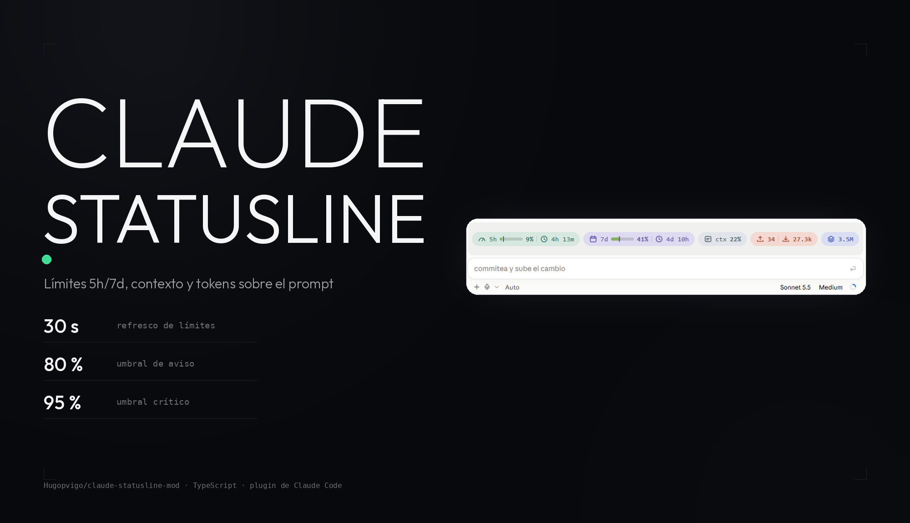
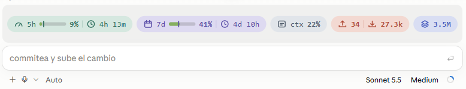

<p align="center">
  
</p>

<p align="center">
  <b>Una banda de estado sobre el prompt de Claude Code, en píldoras de color.</b><br>
  Límites de 5 horas y 7 días con barra y cuenta atrás, contexto y tokens de la sesión.
</p>

<p align="center">
  
  
  
  
</p>

---

## Qué es esto

Un plugin de Claude Code que dibuja, justo encima del prompt, una fila de
píldoras con el estado de la sesión: cuánto llevas gastado de los límites de
**5 horas** y **7 días**, cuánto de la **ventana de contexto** y cuántos
**tokens** has movido.

```
5h ▰▱▱▱▱▱ 9% · ↻ 4h 13m    7d ▰▰▱▱▱▱ 41% · ↻ 4d 10h    ▣ ctx 22%    ↑ 34 · ↓ 27.3k    ▤ 3.5M
```

En la app de escritorio la misma información se dibuja como SVG, con
píldoras redondeadas, iconos y modo claro y oscuro automático:



> Proyecto no oficial. Usa los *function hooks* de Claude Code, que están en
> acceso anticipado: su API puede cambiar sin aviso.

## Qué muestra

| Píldora | Qué es | De dónde sale |
|---|---|---|
| `5h` | % del límite de 5 horas, barra y cuenta atrás hasta el reset | `$.session.usage()` → `rateLimits`, clase `five_hour` |
| `7d` | % del límite semanal, barra y cuenta atrás hasta el reset | ídem, clase `seven_day` |
| `ctx` | % de la ventana de contexto usada | `$.session.usage()` → `context.percent` |
| `↑` `↓` | tokens de entrada y de salida acumulados (en la misma píldora) | `usage` de cada `turn.complete` |
| `▤` | tokens de caché (lectura + escritura) | ídem |

- **Marca de ritmo.** La barra de cada límite lleva una marca vertical: la
  parte del periodo que ya ha pasado. Si el relleno la sobrepasa, estás
  gastando más rápido de lo que toca.
- **Colores por umbral.** Verde por debajo del 80 %, ámbar entre el 80 % y el
  95 %, rojo a partir del 95 %.
- **Avisos.** Al cruzar el 80 % y el 95 % de un límite, escribe una línea en el
  transcript con el límite y el tiempo que queda para el reset. Solo una vez
  por ciclo: cuando cambia la hora de reset, los avisos se rearman.
- **Dos superficies.** En la app de escritorio, SVG; en terminal, texto con
  fondo de color.

Las píldoras `5h` y `7d` solo salen si la sesión expone esos límites (cuenta
con suscripción). `ctx` y los tokens salen siempre: `ctx`, desde el primer
muestreo; los tokens, a partir del primer turno.

## Requisitos

- Claude Code con *function hooks* disponibles (acceso anticipado).
- Para los límites `5h` y `7d`, cuenta con suscripción.

## Instalación

1. Activa los function hooks en `~/.claude/settings.json`:

   ```json
   { "env": { "CLAUDE_CODE_ENABLE_FUNCTION_HOOKS": "1" } }
   ```

2. Clona el repositorio:

   ```bash
   git clone https://github.com/Hugopvigo/claude-statusline-mod.git
   ```

3. En Claude Code: `/plugin` → instalar plugin local → elige la carpeta
   clonada. En la app de escritorio, sube la carpeta como plugin local.
4. Reinicia Claude Code. Las sesiones abiertas antes no cargan el plugin.
5. Manda un mensaje: la banda aparece sobre el prompt.

Para comprobar el plugin sin cargarlo:

```bash
claude plugin validate claude-statusline-mod
```

## Ajustes

Todo son constantes al principio de [`hooks/register.tsx`](hooks/register.tsx):

| Constante | Por defecto | Qué hace |
|---|---|---|
| `SCALE` | `1.35` | Tamaño de la banda en escritorio (vectorial, no pierde nitidez) |
| `TICK_MS` | `30000` | Cada cuánto se refrescan límites y cuentas atrás |
| `WARN_AT` / `CRIT_AT` | `80` / `95` | Umbrales de color y de aviso |
| `FONT`, `ICON_PX`, `CW` | `15`, `19`, `8.6` | Fuente, iconos y ancho de carácter del SVG (cambia `CW` con `FONT`: ≈ 0,57 × FONT) |

## Alternativa clásica (sin function hooks)

[`skills/status/statusline.ts`](skills/status/statusline.ts) es un script
`statusLine` normal: lee por `stdin` el JSON que Claude Code envía y escribe
una línea de texto con colores ANSI. Muestra modelo, cronómetro de sesión,
tokens, % de contexto y los % de 5 h y 7 d si vienen en el JSON; cada métrica
sin dato se omite, así que nunca falla. No muestra píldoras ni límites vivos,
pero no necesita acceso anticipado.

Detalle, campos admitidos y ejemplo de instalación en
[`skills/status/SKILL.md`](skills/status/SKILL.md).

## Desarrollo

```bash
make install      # npm install
make typecheck    # npx tsc -p .
make validate     # claude plugin validate .
```

La declaración de tipos de la API la genera Claude Code (`/plugin-types`
dentro de una sesión en esta carpeta, que escribe `.claude/types/`). No se
versiona, así que el typecheck solo pasa después de generarla.

## Limitaciones

- Los tokens `↑ ↓ ▤` cuentan desde que el plugin carga, no desde el inicio
  de la sesión. Con `--resume` o tras recargar el plugin empiezan de cero.
- El SVG fija el ancho de cada carácter para que el texto no se desalinee; con
  una fuente monoespaciada muy distinta puede verse algo estirado.
- Un módulo de function hooks es un solo fichero: el entorno no resuelve
  imports de código relativos. Por eso los helpers viven dentro de
  `register.tsx`.
- El motor lee los átomos de estado con análisis estático: `read($, atomo)`
  solo admite constantes del fichero, no parámetros.

## Estructura

```
claude-statusline-mod/
├── .claude-plugin/plugin.json   manifiesto del plugin (nombre, versión, licencia)
├── hooks/hooks.json             declara el módulo de function hooks
├── hooks/register.tsx           la banda: render, muestreo de límites y tokens
├── hooks/render.ts              formateador de la alternativa clásica
├── skills/status/statusline.ts  script `statusLine` sin function hooks
├── skills/status/SKILL.md       documentación de la alternativa clásica
├── types/index.d.ts             contrato del estado ($.state) del módulo
├── docs/capturas/               cabecera y captura de la banda
├── Makefile                     install / typecheck / validate
└── package.json                 solo TypeScript como dependencia de desarrollo
```

## Licencia

MIT. Ver [LICENSE](LICENSE).
